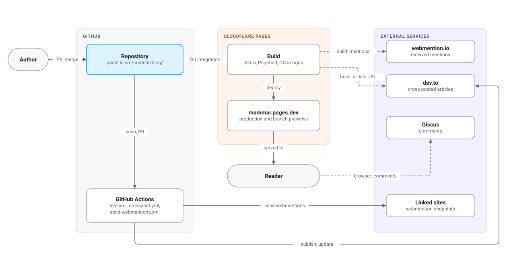
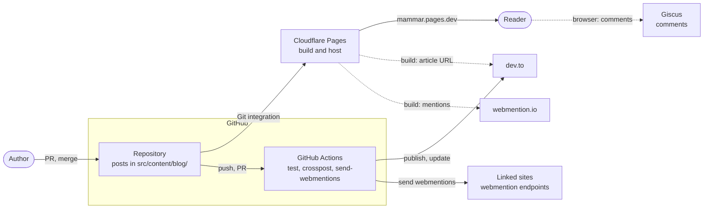
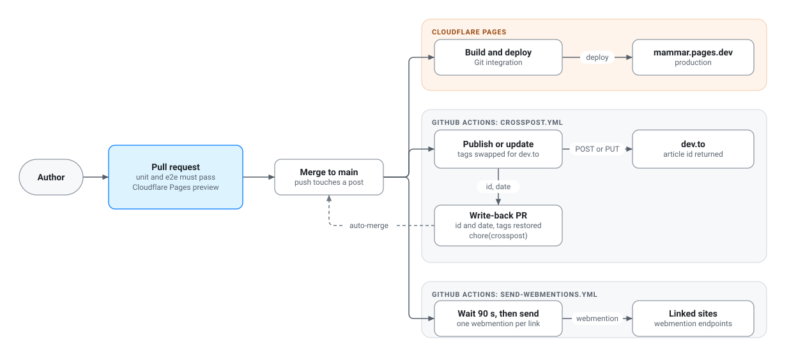
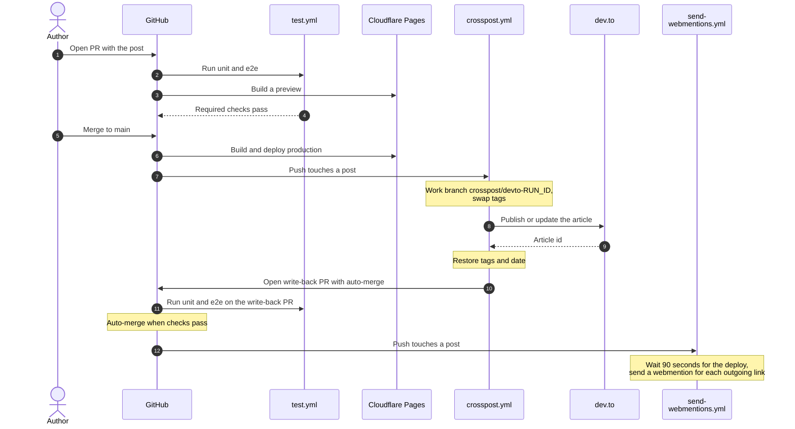
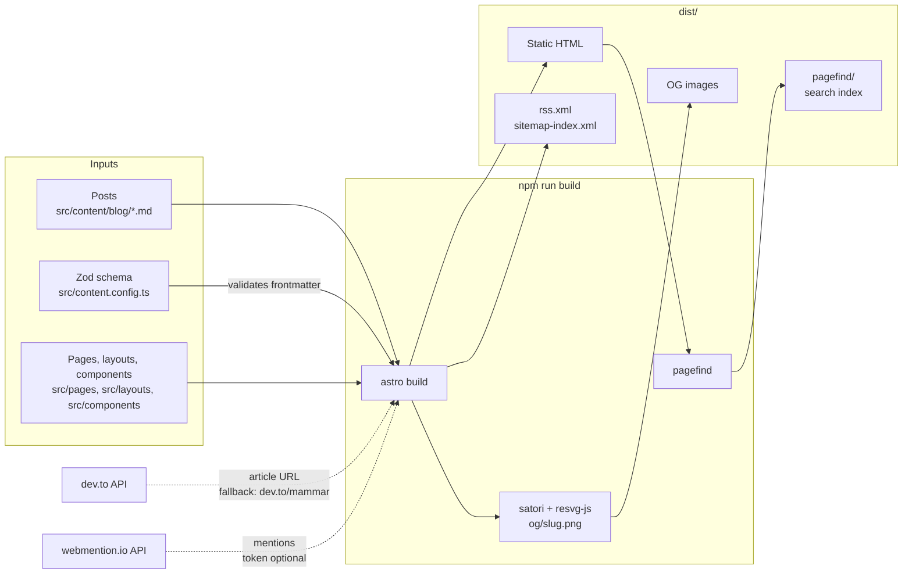
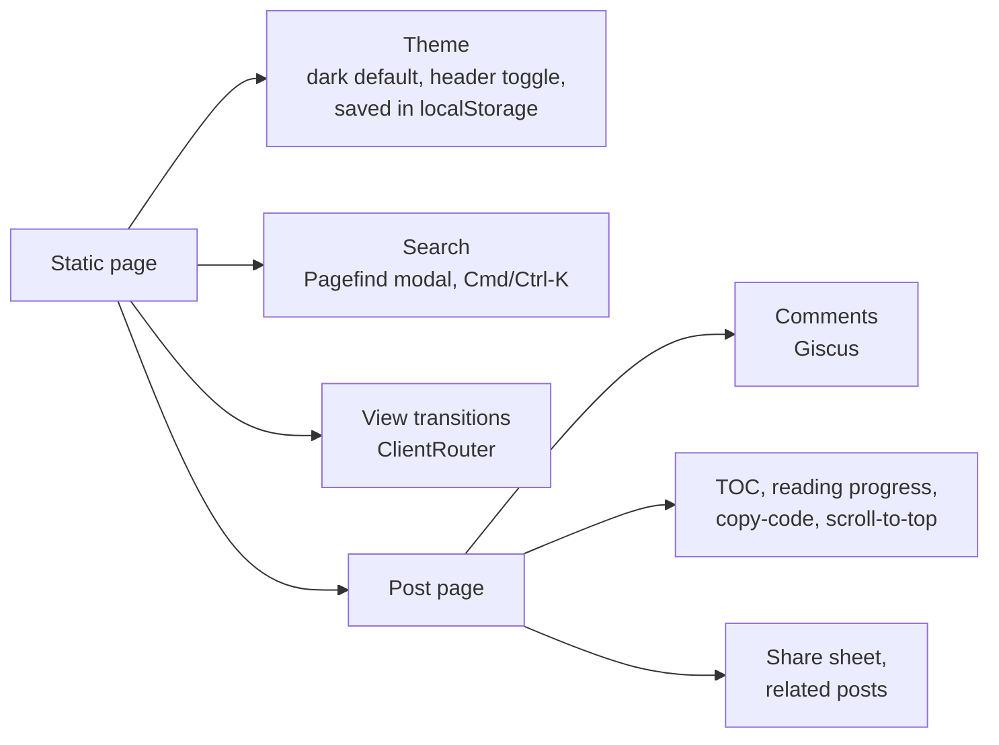

# Architecture

writeups is a static blog. Posts are Markdown files in the repo. Astro turns them into plain HTML, and Cloudflare Pages serves that HTML. GitHub Actions run the tests, copy each post to dev.to, and send webmentions. Pushes to `main` start all of this. Nothing runs on a server of its own.

<picture>
  <source media="(prefers-color-scheme: dark)" srcset="diagrams/overview-dark.svg">
  
</picture>

## 1. System context

The repo on GitHub is the center. Cloudflare Pages builds and hosts the site. GitHub Actions talk to dev.to and to other sites. Two outside services are called while the site builds. Giscus runs in the reader's browser.

- Cloudflare Pages builds every branch. `main` goes to production at <https://mammar.pages.dev>. Other branches get a preview. The "Cloudflare Pages" check on a PR shows that the integration works.
- Both build-time calls (dev.to and webmention.io) fall back to a default when they fail. A failed call never fails the build.

## 2. Publishing a post

Every change goes through a PR. The workflows start after the merge.

<picture>
  <source media="(prefers-color-scheme: dark)" srcset="diagrams/publish-flow-dark.svg">
  
</picture>

The same flow, step by step:

- The write-back commit message starts with `chore(crosspost):`. `crosspost.yml` skips pushes with that prefix, so it does not loop.
- The write-back PR carries the dev.to `id` and the `date` back to `main`. The next run then updates the same article.
- `send-webmentions.yml` also starts on the write-back merge, because that merge touches a post.

## 3. The build

`npm run build` runs `astro build` and then Pagefind.

- Astro checks each post's frontmatter against the Zod schema. A bad field fails the build.
- `src/lib/devto.ts` looks up the article URL from the `id` in the frontmatter. It times out after 5 seconds and falls back to `https://dev.to/mammar`.
- `src/lib/webmentions.ts` reads mentions from webmention.io. `WEBMENTION_IO_TOKEN` is optional. A failed call gives an empty list.

## 4. In the browser

The site ships as static files. A few scripts add behavior on top.

- Search loads the Pagefind index from `/pagefind/` on first use.
- Giscus loads its script from giscus.app when the comments area is near the viewport. It takes the theme from the page. When the page has no saved theme, it uses the OS setting. See the weak spots below.

## 5. Workflows

All workflows are in `.github/workflows/`. Each workflow sets `permissions: {}` at the top. The jobs add only what they need.

| Workflow | Trigger | What it does | Secrets | Job permissions |
|---|---|---|---|---|
| `test.yml` | PR to `main`, push to `main` | `unit` runs Vitest. `e2e` builds the site and runs Playwright. | none | none |
| `crosspost.yml` | Push to `main` that touches `src/content/blog/**`, or manual | Publishes or updates the post on dev.to. Opens a write-back PR with auto-merge. | `DEVTO_TOKEN`, `CROSSPOST_PAT` | `contents: write` |
| `send-webmentions.yml` | Push to `main` that touches `src/content/blog/**` | Sends outgoing webmentions for each post. | none | none |
| `diagnose-devto.yml` | Manual | Repeats one dev.to publish call and prints the response. | `DEVTO_TOKEN` | `contents: read` |

Other settings:

- Dependabot checks npm and GitHub Actions weekly. Dependabot alerts and security updates are on.
- `main` needs a PR. The required checks are `unit` and `e2e`, and the branch must be up to date. History is linear. Admins can bypass these rules.
- `crosspost.yml` opens its PR with `CROSSPOST_PAT`, not `GITHUB_TOKEN`. A PR opened by `GITHUB_TOKEN` does not start `test.yml`, so the required checks would never run.

## 6. Known weak spots

These are tracked in the issues below.

- Cross-post: the auto-merge step fails. Tracked in [#67](https://github.com/MohammedEl-sayedAhmed/writeups/issues/67).
- Cross-post: `sinedied/publish-devto` is pinned to a tag that runs on Node 16. Tracked in [#68](https://github.com/MohammedEl-sayedAhmed/writeups/issues/68).
- Astro is pinned at 7.1.1, which has a critical advisory. Tracked in [#70](https://github.com/MohammedEl-sayedAhmed/writeups/issues/70).
- CI has no type check, no lint and no coverage report. Tracked in [#71](https://github.com/MohammedEl-sayedAhmed/writeups/issues/71).
- The Giscus theme can follow the OS setting, so comments can show in the light theme on the dark site. Tracked in [#73](https://github.com/MohammedEl-sayedAhmed/writeups/issues/73).
